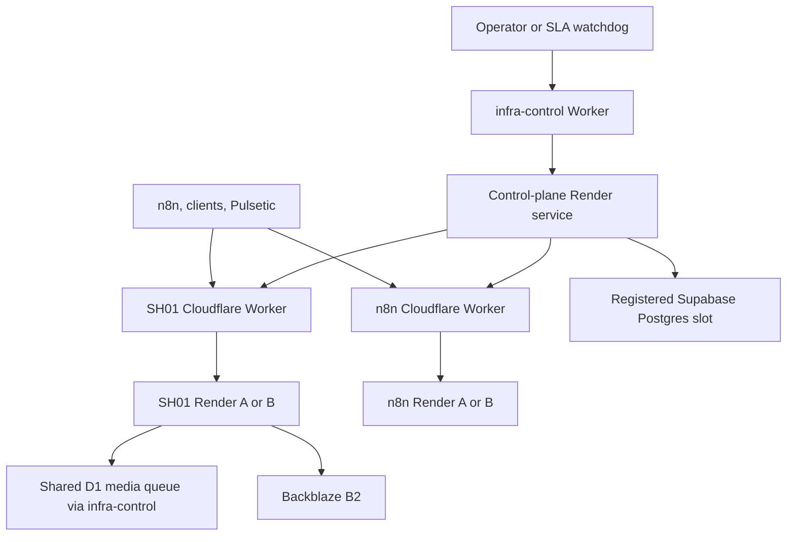

# SH01 FastAPI server

SH01 is a FastAPI service for media production, Telegram-backed media storage, Google Sheets utilities, and publishing integrations. The same repository also contains an infrastructure control plane that coordinates paired n8n and SH01 Render services, Postgres slots, Backblaze B2 slots, and Cloudflare routers.

This README describes the code on `main` and the Cloudflare dashboard setup used with it. It does not contain credentials. Treat the live router and control-plane status APIs as the source of truth for the **currently active** Render, Postgres, and B2 slots.

## Entry points and topology

| Address | Purpose | Credential for protected endpoints |
| --- | --- | --- |
| `https://sh01.vivojaymail.workers.dev` | Stable public SH01 API proxy | Endpoint-specific SH01 key; media editing generally uses `MEDIA_CLIP_API_KEY` as `X-API-KEY` |
| `https://n8n-prod-1.vivojaymail.workers.dev` | Stable n8n proxy | n8n's own authentication |
| `https://infra-control.vivojaymail.workers.dev` | Stable control-plane proxy and shared media queue API | `/infra/*`: `CONTROL_PLANE_API_KEY` as `X-API-KEY`; `/internal/media-jobs/*`: `MEDIA_JOB_STORE_API_KEY` as `X-MEDIA-JOB-KEY` |
| `http://127.0.0.1:5000` | Local Docker/Uvicorn API | Same application keys as appropriate |

The Cloudflare SH01 and n8n Workers each have a list of Render origins and a preferred origin persisted in their **separate** `ROUTER_STATE` KV namespaces. Paired Render slots are `render-a` (one n8n service plus one SH01 service) and `render-b` (another n8n service plus another SH01 service). Postgres and B2 selections are independent of the Render pair. The registry in `infra_registry.example.json` shows the environment-variable references needed to register additional slots.



`infra-control` Worker deployment and its D1 binding currently live in the **Cloudflare dashboard**; its source is not checked into this repository. The repository does include `cloudflare/sh01-worker.js`, `cloudflare/n8n-prod-1-worker.js`, and `cloudflare/infra-sla-watchdog-worker.js`. The adjacent `wrangler.*.example.jsonc` files are reference configurations; dashboard users can enter their variables, secrets, KV bindings, and schedules in the Cloudflare UI without running Wrangler.

### Router behavior

The SH01 and n8n router control endpoints are `GET /__control/status`, `POST /__control/preferred`, and `POST /__control/maintenance`; send `X-ROUTER-KEY` matching that Worker's `ROUTER_CONTROL_KEY`. Preferred backends must appear in that Worker's `BACKENDS` list. `ALLOW_FALLBACK=false` means a preferred origin failure **does not** automatically try the other origin at the router; set it according to your intended routing policy. The control plane also has SLA tick and explicit failover routes. A healthy proxy response proves which origin served **that request** via `x-backend-used`; it does not prove both standbys are available.

Pulsetic is an external pinger in this deployment. Configure and check its individual monitors in Pulsetic; the repository does not manage them. Pinging one proxy URL repeatedly generally tests the preferred origin, not each configured Render origin independently. If the operational goal is to keep each free Render service awake, verify that every monitor reaches its intended origin.

## Run the application

The Docker image includes Python 3.11, FFmpeg/ffprobe, and `postgresql-client`; its default command starts one Uvicorn worker on port 5000. Locally, install FFmpeg/ffprobe separately if not using Docker. Features require their own credentials and external services; simply starting the API does not configure them.

```bash
git clone https://github.com/BarrieBretton/sh01-fastapi-server.git
cd sh01-fastapi-server
python -m venv .venv
source .venv/bin/activate
python -m pip install -r requirements.txt
uvicorn app:app --host 127.0.0.1 --port 5000 --workers 1
```

For Docker, build with `docker build -t sh01 .` and supply environment variables when starting the container. See `Dockerfile`; `render.yaml` is a historical Render export, **not** a complete specification of current Cloudflare bindings or the D1 queue. FastAPI's local OpenAPI schema is at `http://127.0.0.1:5000/openapi.json` and interactive docs at `/docs`.

### Key configuration by role

| Role | Important settings | What they do |
| --- | --- | --- |
| SH01 media worker | `MEDIA_CLIP_API_KEY`, `BACKBLAZE_KEY_ID`, `BACKBLAZE_APPLICATION_KEY`, `BACKBLAZE_BUCKET_NAME`, `MEDIA_JOB_STORE_MODE=remote`, `MEDIA_JOB_STORE_API_KEY`, `CONTROL_PLANE_BASE_URL=https://infra-control.vivojaymail.workers.dev`, `MEDIA_QUEUE_CONSUMER_ENABLED=true` | Authenticate media requests, store rendered videos, enqueue/claim jobs through the shared queue. |
| Limited Render media worker | `MEDIA_ALLOW_UNLIMITED_RESOURCES=false` | Reject `unlimited_resources=true` requests; apply the resource-limited path. |
| High-resource local/Kaggle worker | `MEDIA_ALLOW_UNLIMITED_RESOURCES=true`, `MEDIA_QUEUE_CONSUMER_ENABLED=true`, `MEDIA_LOCAL_SOURCE_DIR=<readable input directory>` | Permit explicitly requested high-resource jobs and local `source_path` inputs. The job must execute on a host that can read that path. |
| Control-plane application | `CONTROL_PLANE_API_KEY`, `INFRA_REGISTRY_JSON`, `ACTIVE_RENDER_SLOT`, `ACTIVE_POSTGRES_SLOT`, `ACTIVE_B2_SLOT`, provider credentials, router base URLs and router keys; `MEDIA_QUEUE_CONSUMER_ENABLED=false` | Manage paired slots and infrastructure state; do not consume media jobs. |
| Cloudflare SH01/n8n routers | `BACKENDS`, `ALLOW_FALLBACK`, `ROUTER_CONTROL_KEY` secret, dedicated `ROUTER_STATE` KV binding | Route requests and persist preferred origin and maintenance state. |
| Cloudflare infra-control Worker | Dedicated D1 binding and matching media queue key, configured in Cloudflare UI | Serve the canonical media queue at `/internal/media-jobs/queue/*`; configure according to the version actually deployed in the dashboard. |
| SLA watchdog Worker | `CONTROL_PLANE_BASE_URL`, `CONTROL_PLANE_API_KEY`, optional `WATCHDOG_MANUAL_KEY`, scheduled trigger | Call `POST /infra/sla/tick` on a schedule; `/health` is a separate health check. |

`CONTROL_PLANE_API_KEY`, `MEDIA_CLIP_API_KEY`, `MEDIA_JOB_STORE_API_KEY`, and `ROUTER_CONTROL_KEY` have **different purposes**. Do not substitute one for another merely because several endpoints use an API-key header. Set secrets separately on each service that needs them. Set `PUBLIC_API_BASE=https://sh01.vivojaymail.workers.dev` on SH01 instances if generated status/media URLs should use the public proxy.

Useful optional media settings include `MEDIA_CLIP_WHISPER_MODEL`, `MEDIA_CLIP_WHISPER_VAD`, `MEDIA_CLIP_RENDER_WIDTH`, `MEDIA_CLIP_RENDER_HEIGHT`, `MEDIA_CGROUP_RESERVE_MB`, `MEDIA_FFMPEG_MAX_RSS_MB`, `MEDIA_WHISPER_MAX_RSS_MB`, `MEDIA_MAX_INPUT_PIXELS`, `MEDIA_QUEUE_POLL_SECONDS`, and `AUTO_EDIT_MAX_SEGMENTS`. Defaults and bounds live in `caption_router.py`, `media_resources.py`, `media_dispatcher.py`, and `auto_editor.py`. On free or small instances, an accepted request can still fail at a memory admission check; the controls are safeguards, not a guarantee that every input fits.

The media queue requires `MEDIA_JOB_STORE_MODE=remote` on consumers and access to the deployed Cloudflare queue API. It is **not selected by `MEDIA_QUEUE_POSTGRES_SLOT`**, nor does it automatically switch to the currently active Supabase slot. Infrastructure state and other workloads still use the configured Postgres ring. `MEDIA_JOB_STORE_SETUP.md` describes an earlier media-store topology; use the D1 queue settings above for this deployment.

## Main API surfaces

| Routes | What they do | Notes |
| --- | --- | --- |
| `POST /media/auto-edit`, `GET /media/auto-edit-jobs/{job_id}` | Automatic cuts, transcription, captions, effects, branding, and render status | Async queue; send media `X-API-KEY`. |
| `GET /media/auto-edit-capabilities`, `GET /media/auto-edit-presets` | Discover enabled settings and preset starting values | Send media `X-API-KEY`; advertised render size comes from the serving instance. |
| `POST /media/clip-caption`, `GET /media/clip-caption-jobs/{job_id}`, `GET /media/clip-caption-presets` | Caption a video clip | Separate media job type; shared queue. |
| `POST /media/audio-image-video`, `GET /media/render-jobs/{job_id}` | Render Telegram audio with a supplied image | Shared queue; uses `queue_id` for idempotency. |
| `GET /media/rendered/{token}` | Redirect to a temporary B2 download URL | Public output URL; deletion requires authentication. |
| `POST /img/render` | Render a still image template with text, gradients, logos, and static edge text | Input background is a URL. Moving text is video-only. |
| `/telegram/*`, `/b2/*`, `/yt/videos`, `/sheets/process_streamables`, `/kite/*` | Telegram media index, B2, YouTube metadata, Sheets/Streamables, and Kite integrations | Read the route and its auth requirements before use. Streamables is gated for local use by `ALLOW_LOCAL_PROCESS_STREAMABLES=true`. |
| `/threads/*`, `/tumblr/*`, `/x/*` | Social publishing backends | See `docs/SOCIAL_DISTRIBUTION.md` for account mappings and operational status. |
| `/infra/*` | Control-plane health, registry, status, migration, router checks, SLA, and failover | Send `X-API-KEY: <CONTROL_PLANE_API_KEY>`. |

This route list is an overview; the generated OpenAPI schema and request models provide the exact fields. In particular, `/yt/videos` lists YouTube metadata; it is **not** a general endpoint for downloading a timed YouTube video excerpt.

### Automatic editing example

Send exactly one of `source_url`, `telegram_file_id`, or `source_path`. `source_path` must be inside `MEDIA_LOCAL_SOURCE_DIR` **on the worker that claims the job**; a path on a caller's laptop is not a path on Render. For a remote n8n workflow, use a reachable URL or Telegram file ID. `start_seconds` and `end_seconds` select a window on the supplied source. `target_seconds` is an edit target, not an exact final duration.

```bash
BASE='https://sh01.vivojaymail.workers.dev'
: "${MEDIA_CLIP_API_KEY:?Set the media key locally}"

curl -fsS "$BASE/media/auto-edit-presets" \
  -H "X-API-KEY: $MEDIA_CLIP_API_KEY"

curl -fsS "$BASE/media/auto-edit" \
  -H "X-API-KEY: $MEDIA_CLIP_API_KEY" \
  -H 'Content-Type: application/json' \
  --data-binary '{
    "source_url": "https://example.com/source.mp4",
    "request_id": "my-video-001",
    "start_seconds": 30,
    "end_seconds": 90,
    "target_seconds": 50,
    "output_count": 1,
    "preset": "viral_punch",
    "captions_enabled": true,
    "remove_silence": true,
    "fit_mode": "crop",
    "dynamic_zoom": "punchy",
    "zoom_shots": [1, 3],
    "zoom_ramp_seconds": 4,
    "zoom_overrides": [{"shot": 3, "direction": "out", "amount": 0.08}],
    "caption_overrides": {
      "animation": "bounce",
      "animation_scope": "phrase",
      "grouping": "phrase",
      "highlight_mode": "word",
      "primary": "&H00FFFFFF",
      "highlight": "&H00FFFF00"
    },
    "unlimited_resources": false
  }'
```

The POST normally returns a `job_id` and a `status_url`; poll `GET /media/auto-edit-jobs/{job_id}` with the same header until `complete` or `failed`. A completed job returns `outputs` containing `video_url`, duration, and an `edit_decision_list` with source/output intervals and per-shot zoom details. Captions use ASS color notation (`&HAABBGGRR`), so `&H00FFFF00` represents cyan. Setting `captions_enabled=false` suppresses generated captions while allowing transcript-driven cuts. Select `zoom_shots=[]` to suppress all selected-shot zooms or `dynamic_zoom="off"` to disable the effect globally. Shot numbers refer to **final selected shot order**, not source timestamps.

`crop_x_px`, `crop_y_px`, and `crop_scale` optionally position a fixed crop over the scaled source. They use final-render pixel coordinates after source scaling, rather than CSS positions; omit `crop_x_px`/`crop_y_px` for automatic framing. `MEDIA_CLIP_RENDER_WIDTH` and `MEDIA_CLIP_RENDER_HEIGHT` configure output dimensions for an instance; do not assume every instance renders 1080 × 1920. `reframe="auto"` samples visual activity and does not track faces.

Video preset names are `viral_punch`, `clean_minimal`, `karaoke_glow`, `podcast_bold`, and `cinematic`. A preset supplies default cut, effect, caption, and subtle branding values; explicitly supplied request fields override edit defaults. `branding` accepts up to one two-stop gradient per edge, one logo per corner, and four edge-text entries. Gradient colors use `#RRGGBB` with independent 0–1 opacities; logos use public image URLs, size, margin, and opacity. Edge text can be `static`, single-edge `marquee`, connected-edge `path`, or four-edge `loop`. Set `"branding":{"enabled":false}` to suppress preset branding. See the models and docstrings in `media_branding.py` for the validation rules and exact payload schema.

### Verify routers and the queue (PowerShell)

Set key variables from your secret manager; do not place their values in a committed script.

```powershell
$Control = 'https://infra-control.vivojaymail.workers.dev'
$Sh01 = 'https://sh01.vivojaymail.workers.dev'

Invoke-RestMethod "$Control/infra/health" `
  -Headers @{ 'X-API-KEY' = $ControlPlaneApiKey } -UseBasicParsing

Invoke-RestMethod "$Control/internal/media-jobs/queue/health" `
  -Headers @{ 'X-MEDIA-JOB-KEY' = $MediaJobStoreApiKey } -UseBasicParsing

Invoke-RestMethod "$Sh01/__control/status" `
  -Headers @{ 'X-ROUTER-KEY' = $Sh01RouterKey } -UseBasicParsing

Invoke-RestMethod "$Sh01/media/auto-edit-capabilities" `
  -Headers @{ 'X-API-KEY' = $MediaClipApiKey } -UseBasicParsing
```

The router response shows `preferred`, `effective_order`, `allow_fallback`, `maintenance`, and `persistence_available`. To see the backend that actually handled a proxied call, use `Invoke-WebRequest -UseBasicParsing` and read `$response.Headers['x-backend-used']`. In Windows PowerShell, `-UseBasicParsing` also avoids the legacy HTML parsing warning. If a request succeeds through a proxy, it does not by itself validate the other Render origins or the security keys for another route.

## Media queue and resource boundaries

`media_job_store.py` submits queue requests to the infra-control URL. The Cloudflare D1 queue holds job status and claims; `media_dispatcher.py` runs only where `MEDIA_QUEUE_CONSUMER_ENABLED=true`. It claims one heavy job at a time through `media_capacity.py` and uses heartbeat/lease ownership. A dedicated high-resource consumer is required for `unlimited_resources=true` jobs. `media_admission.py` coordinates other heavy request paths against the same queue; those paths may return a busy response instead of enqueueing.

Small-host handling uses FFmpeg thread limits, bounded subprocess RSS checks, cgroup headroom admission, pixel limits, and isolated Whisper transcription. A process can be refused or stopped to protect a limited host; video decode, complex filters, and concurrent unrelated processes still require capacity. Keep `MEDIA_ALLOW_UNLIMITED_RESOURCES=false` on small Render instances. A shared queue coordinates **jobs** across SH01 instances; it does not make an unreachable `source_path` accessible on another host, and it does not promise that every source can be rendered within a 512 MiB container.

When troubleshooting a job, save its `job_id`, last `status`, `stage`, `error`, and `outputs`. For render quality, compare the input and output stream start times with `ffprobe`, inspect the returned edit decision list to see which spans were removed, and view the output itself. Whisper VAD and speech timestamps drive speech-oriented silence cuts; background noise and subject motion mean a cut decision still needs review.

## Control plane and operations

The control-plane API is implemented in `infra/` and exposed under `/infra` with `CONTROL_PLANE_API_KEY`. `GET /infra/health` returns the selected state; `GET /infra/status` lists active and available slots; `GET /infra/router/status` checks the routers; `GET /infra/sla/status` reports SLA tracking. Mutating operations include `/infra/failover`, `/infra/select/*`, and `/infra/sla/tick`. Use the provided `scripts/infra_smoke.ps1` for controlled validation; read its parameters before any live failover. `scripts/infra_sla_test.ps1` covers the SLA path.

The watchdog Worker calls `POST /infra/sla/tick` using the control-plane key. Its code includes a scheduled handler and `/health`, plus a separately protected manual `POST /tick`. A Cloudflare scheduled trigger must be configured for automatic ticks. `infra/sla.py` implements readiness checks and paired Render-slot promotion; its lock is local to the control-plane process. Running multiple independent control-plane instances does **not** create a distributed control-plane election or automatically synchronize concurrent mutations. Treat the control-plane proxy as a stable address and verify its own backend routing and the shared durable state when changing the deployment.

Database migration and service environment changes are operationally sensitive; follow `CONTROL_PLANE_SETUP.md`, `PAIRED_RENDER_MIGRATION.md`, and `TEST_CHECKLIST.md`. In the registry examples, Postgres migration tooling uses port 5432 and n8n runtime configuration can use the transaction pooler port 6543. The migration code currently targets the `public` schema. B2 destination pruning is destructive and opt-in.

## Social distribution

`threads_feature/`, `tumblr_feature/`, and `x_feature/` implement platform backends. Consult `docs/SOCIAL_DISTRIBUTION.md` for account mapping, API-key resolution, token storage, migrations in `sql/`, and the actual production status of each network. The checked-in documentation describes Threads and Tumblr paths as active, X as parked, and TikTok as workflow scaffold only. This repository does not expose a production TikTok publishing endpoint. Meta/Facebook publishing and Google Sheets/Telegram helpers remain in `app.py` and related modules.

For n8n integrations, submit to the appropriate **stable SH01 Cloudflare URL** and set an HTTP Header Auth credential with the key expected by that endpoint. The control-plane key is for `/infra/*`, not the SH01 media editor. Job completion is asynchronous: submit, poll the returned job ID, then consume the output URL. Store request IDs in n8n for idempotent retries.

## Repository map

| Path | Responsibility |
| --- | --- |
| `app.py` | FastAPI assembly; Telegram, B2, Sheets, Kite, YouTube metadata, legacy social handlers |
| `auto_editor.py`, `caption_router.py`, `media_router.py`, `media_branding.py` | Media jobs, captions, effects, templates, branded video layers |
| `image_templating.py` | Still-image rendering at `/img/*` |
| `media_dispatcher.py`, `media_job_store.py`, `media_capacity.py`, `media_admission.py`, `media_resources.py` | Durable queue client, one-job admission, limited-host resource controls |
| `infra/`, `infra_registry.example.json` | Infrastructure state, registry, provider checks, migration, SLA and failover |
| `cloudflare/` | Tracked SH01/n8n proxy code, watchdog, and configuration examples |
| `threads_feature/`, `tumblr_feature/`, `x_feature/`, `sql/` | Social publishing and database migrations |
| `scripts/`, `docs/` | Operational scripts and detailed integration documentation |

Never commit credentials, exported browser cookies, real customer media, local `.env` files, or logs. Keep values in the relevant Render or Cloudflare secret settings and your local secret store.
