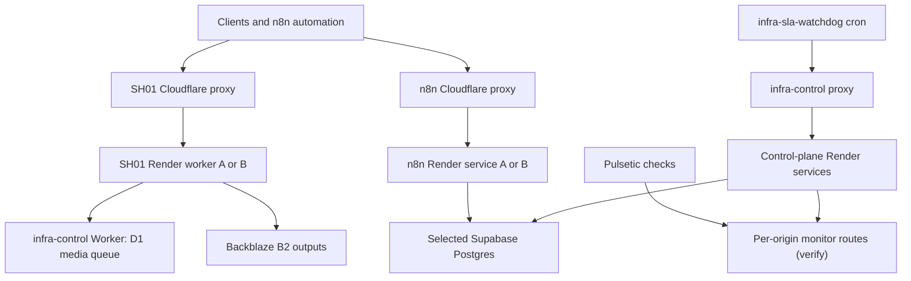

# SH01 project handbook

**Purpose:** This is the maintained starting point for a developer or AI with no prior conversation context. It maps the application to external infrastructure and records what is known, what was observed, and what still needs an export or dashboard check.

**Baseline checked:** GitHub `BarrieBretton/sh01-fastapi-server` `main` at `24f8924bd974418e309afdc48d83832f5e244c4e` on 20 October 2026. The operator also reported a successful Kaggle end-to-end branded video render on 20 October 2026. Configuration can change without a Git commit; check live dashboards before changing production.

## How to read and update this handbook

### Clickouts consumer — source update 15 November 2026

**Code:** Starting from remote `main` at `c82f0a47ad4c9d75c5ff27e4ed2334703bbfa3f1`,
the SH01 server now mounts `/social/clickouts/{status,preview,run,tick}` via
`clickouts_routes.py`. `clickouts_worker.py` consumes confirmed-queue identities
from the existing workbook's `clickouts` tab; only provider-confirmed deletions
are marked `status=done`, without removing rows. Google row metadata and shared
Redis records support safe status recovery and prevent blind repeat DELETE calls.

One `Server::Clickouts` (alias `Python::Clickouts`) row in `Workflow-Schedule`
controls daily timings in Asia/Kolkata and uses `Run as Job Today` as its enable
flag. `Associated Accounts` can be blank. The scheduler starts only when
`SOCIAL_DELETE_ENABLED=1`; protected Clickouts routes reuse `MEDIA_CLIP_API_KEY`.
An existing `SOCIAL_INVENTORY_API_KEY` is also accepted, without overriding the
media key. No additional API-key variable is required on Render instances.
This correction is based on remote `main` at `5c04906b589e0a533fa0161b8f63c48b5a2e0866`.
Existing Google credentials, `SPREADSHEET_ID`, shared
`REDIS_URL`, and Meta credentials are reused. Operations Desk receipts require
its existing ingest credential (`OPS_INGEST_TOKEN` on SH01).

**Unverified:** live deployment, Redis persistence, the workbook schedule row,
Meta deletion permissions/app eligibility, and actual deletions. Offline tests
are not production execution evidence. Full setup, failure states, API limits,
and read-only verification: [Clickouts automation](CLICKOUTS_AUTOMATION.md).

Evidence labels in the tables:

- **Code:** directly present in the named repository file at the baseline commit.
- **Observed:** operator supplied an HTTP response, working output, or direct result in this project. This is a point-in-time observation.
- **Reported:** described by the operator; the corresponding dashboard/export has not been inspected here.
- **Unknown:** a name, binding, URL, schedule, credential reference, or live state still needs recording.

When a deployment, n8n workflow, credential reference, cron, KV binding, or code path changes, update its section in this file in the **same change** that modifies the system. Record a non-secret proof: git commit, sanitized workflow export, Cloudflare Worker version/date, or a redacted health response. Never paste actual secrets, browser cookies, tokens, database URLs with passwords, signed media URLs, or live credential values into Git.

Read [README.md](../README.md) for local startup and sample calls; this document covers relationships and operational ownership. Source files and live settings take priority over either document if they differ.

## What lives in Git and what does not

| Surface | Where to find the authoritative definition | Recorded state |
| --- | --- | --- |
| FastAPI routes and data models | `app.py`, `auto_editor.py`, `caption_router.py`, `media_router.py`, `image_templating.py`, `infra/routes.py`; run `/openapi.json` for route schemas | Code |
| Shared media queue client and worker consumer | `media_job_store.py`, `media_dispatcher.py`, `media_capacity.py`, `media_admission.py` | Code |
| SH01 and n8n router implementations | `cloudflare/sh01-worker.js`, `cloudflare/n8n-prod-1-worker.js` | Code; confirm dashboard deployment version |
| Cloudflare infra-control router and D1 queue implementation, D1 schema and migrations | Dashboard-managed Worker/D1; **no source or migration history on GitHub `main` at this baseline** | Observed working queue health, source export missing |
| Current Worker variables, secrets, KV namespace IDs, D1 binding ID, schedules, per-origin pingers | Cloudflare dashboard; record **names, types and binding targets** here after inspection | Partial/unknown |
| Render service IDs, environment variable values, deploy revision, paired slot mapping | Render dashboards and live `INFRA_REGISTRY_JSON` | Partial/unknown |
| n8n workflow graphs, trigger cadences, node settings, pinned versions, HTTP Header Auth credential *names* | n8n UI; sanitized workflow exports **are not present in this repo** | Partial/unknown |
| Google Sheets schema, spreadsheet IDs, ownership, tabs | Google Sheets/Drive and n8n settings | Unknown |
| Media QA notebook | `notebooks/sh01_kaggle_branding_endpoint_test.ipynb` (include this file in the same handoff commit) | Operator observed successful video; sample repo artifact |
| Frontends/Cloudflare Pages | No Pages application source or deployment inventory found in this repo | Unknown, do not infer an app exists |

## System map



The control plane selects a **paired** n8n and SH01 Render slot; Postgres and B2 selections are independent. The current Render-to-letter mapping comes from the **live registry**, not from the A/B letter in a hostname or an older document. The media queue's D1 storage is distinct from router KV and from the active Supabase/Postgres slot.

### Public and internal entry points

| Name | URL / route | Responsibility | Evidence |
| --- | --- | --- | --- |
| SH01 public | `https://sh01.vivojaymail.workers.dev` | Stable media, Telegram, image, social, and other FastAPI routes | Code and observed |
| n8n public | `https://n8n-prod-1.vivojaymail.workers.dev` | Stable n8n proxy | Code and reported |
| Control public | `https://infra-control.vivojaymail.workers.dev` | Routes `/infra/*` to a control-plane instance; provides `/internal/media-jobs/queue/*` through its deployed Worker | Observed; Worker implementation not in Git |
| SH01 Render workers | `https://sh01-fastapi-server.onrender.com`, `https://sh01.onrender.com` | API origins behind SH01 router | Code router defaults; exact live mapping in dashboard |
| n8n Render services | `https://n8n-fbal.onrender.com`, `https://n8n-hbek.onrender.com` | n8n origins behind n8n router | Code router defaults; exact live mapping in dashboard |
| Master/control-plane Render | At least `https://sh01-fastapi-server-d0ya.onrender.com` previously observed; second origin is **not verified here** | Control API and infrastructure jobs | Observed one origin |
| Local or Kaggle server | `http://127.0.0.1:5000` in the tested notebook | High-resource test execution through the same FastAPI endpoints | Code and observed |

Router KV bindings are called `ROUTER_STATE` in the checked-in SH01/n8n Workers; give **each Worker its own KV namespace**. Exact namespace names/IDs and the control Worker's KV binding are not in Git. The D1 queue returned `{"ok":true,"queue":"cloudflare-d1"}` in an operator test on 18 October 2026, which does not verify its migration/version history.

## Credentials and boundaries

| Call | HTTP credential | Server-side setting / owner |
| --- | --- | --- |
| `/infra/*` through control proxy | `X-API-KEY` | Control-plane `CONTROL_PLANE_API_KEY` |
| `/internal/media-jobs/queue/*` | `X-MEDIA-JOB-KEY` | Media clients `MEDIA_JOB_STORE_API_KEY`; same key configured on deployed queue Worker |
| `/media/auto-edit*`, `/media/clip-caption*`, audio/image media job routes | `X-API-KEY` | SH01 media key `MEDIA_CLIP_API_KEY` (check fallback in `caption_router.py`) |
| SH01 and n8n `/__control/*` | `X-ROUTER-KEY` | Each Worker's `ROUTER_CONTROL_KEY`; control-plane matches via its role-specific router-key variables |
| `infra-sla-watchdog /tick` | `X-WATCHDOG-KEY` | Optional `WATCHDOG_MANUAL_KEY`; scheduled handler uses the control-plane API key instead |
| Threads, Tumblr, X posting | `X-API-Key` | Platform-specific internal key resolution; see `docs/SOCIAL_DISTRIBUTION.md` |

An n8n HTTP Header Auth credential for SH01 media must set **header name `X-API-KEY` and value the media key**. The control-plane key and queue key are not substitutes. Keep a credential register consisting of **name, use, rotation date, owner, and target environment** without the secret itself.

### Runtime settings worth documenting per deployment

| Group | Names to inspect | Reason |
| --- | --- | --- |
| SH01 queue | `MEDIA_JOB_STORE_MODE=remote`, `CONTROL_PLANE_BASE_URL`, `MEDIA_JOB_STORE_API_KEY`, `MEDIA_QUEUE_CONSUMER_ENABLED`, `MEDIA_QUEUE_POLL_SECONDS`, `MEDIA_QUEUE_HEARTBEAT_SECONDS` | Enqueue/claim and heartbeat |
| SH01 media | `MEDIA_CLIP_API_KEY`, `PUBLIC_API_BASE`, `MEDIA_CLIP_RENDER_WIDTH`, `MEDIA_CLIP_RENDER_HEIGHT`, `MEDIA_CLIP_WHISPER_MODEL`, `MEDIA_CLIP_WHISPER_VAD` | Authentication, render dimensions, transcription |
| Low-resource guard | `MEDIA_ALLOW_UNLIMITED_RESOURCES`, `MEDIA_REQUIRE_CGROUP`, `MEDIA_CGROUP_RESERVE_MB`, `MEDIA_FFMPEG_MAX_RSS_MB`, `MEDIA_WHISPER_MAX_RSS_MB`, `MEDIA_MAX_INPUT_PIXELS` | Render memory admission, not an OOM guarantee |
| B2 | `BACKBLAZE_KEY_ID`, `BACKBLAZE_APPLICATION_KEY`, `BACKBLAZE_BUCKET_NAME` | Durable rendered video and Telegram media |
| Control plane | `CONTROL_PLANE_API_KEY`, `INFRA_REGISTRY_JSON`, `ACTIVE_RENDER_SLOT`, `ACTIVE_POSTGRES_SLOT`, `ACTIVE_B2_SLOT`, `RENDER_API_KEY`, router URLs and keys, `SUPABASE_{A,B}_*` | Provider configuration and bootstrap state |
| n8n/Redis | n8n `DB_POSTGRESDB_*`, shared `N8N_ENCRYPTION_KEY`; app `REDIS_URL`, `N8N_BASE_URL`, `N8N_API_KEY` | n8n persistence/decryption and app daily activation |

The `REDIS_URL` path in `app.py` attempts a Redis `cron_master_lock` and schedules n8n activation at **09:50 Asia/Kolkata**. A live Redis instance, active lock owner, and successful execution of that scheduler have **not been verified**. Do not classify a source-code CronTrigger as an enabled production schedule without dashboard/runtime evidence. Similarly, note the control plane's in-process SLA lock in `infra/sla.py`: multiple independent master processes do not automatically coordinate a global leader.

## Media production contract and the tested notebook

`POST /media/auto-edit` accepts **exactly one** `source_url`, `telegram_file_id`, or `source_path`. Its durable job is enqueued through the infra-control D1 queue and picked up by an opted-in SH01 consumer. Poll `GET /media/auto-edit-jobs/{job_id}`; finished results include video URLs, source/output edit intervals, and per-shot zoom metadata. `GET /media/auto-edit-presets` returns preset starting values and `GET /media/auto-edit-capabilities` reports instance settings. See `auto_editor.py`, `media_branding.py`, and `caption_router.py` for exact validation.

The sample notebook in this documentation package exercises a synced video, user-selected source window, Whisper transcription and VAD, silence cuts, phrase-bounce captions with word highlighting, portrait crop, selected-shot zoom, gradients, four corner logos, moving edge text, an image template, and B2 output. The operator confirmed a successful result on Kaggle on 20 October 2026. This verifies **that run**, not all inputs, Render's 512 MiB performance, every UI workflow, or all preset combinations.

The notebook starts one local SH01 process and uses HTTP endpoints for editing and image generation. Its optional `ffmpeg` call to sync an attached MKV is input preparation; its `ffprobe` checks are verification. If pip upgrades Pillow while the notebook kernel holds old Pillow modules, restart the **kernel** before importing `auto_editor` and rerun setup. Do not include Kaggle-specific cookies, private videos, output files, or rendered B2 URLs in Git.

`unlimited_resources=true` works only on a host with `MEDIA_ALLOW_UNLIMITED_RESOURCES=true`. Keep it **false** for the small Render workers. `source_path` resolves on the **claiming worker**, so a Kaggle path cannot be used through the public Render proxy. A queued job can run on a different SH01 instance; prefer a reachable source URL or Telegram file ID for production.

### Converting the Kaggle run to n8n

The core SH01 render can be orchestrated with standard n8n nodes:

1. **Trigger / input:** receive an already accessible MP4 `source_url` (or a Telegram file ID), time window, preset/overrides, and a stable request ID. Validate that the URL is accessible to the worker.
2. **Set/Edit Fields:** build an auto-edit JSON body. Reuse the notebook's `VIDEO_REQUEST` values for captions, zoom shots, crop and branding; change `source_path` to `source_url` or `telegram_file_id` and `unlimited_resources` to `false` for Render.
3. **HTTP Request:** POST `https://sh01.vivojaymail.workers.dev/media/auto-edit` with an n8n Header Auth credential whose **name is `X-API-KEY`** and value is `MEDIA_CLIP_API_KEY`; save `job_id` and `request_id`.
4. **Wait + HTTP Request + IF:** poll `/media/auto-edit-jobs/{job_id}` with the same header; loop while `queued` or `running`, branch on `complete` and `failed`/`interrupted`. Bound attempts and time; preserve the returned error for investigation.
5. **Output:** read `outputs[0].video_url`; distribute, notify, or append a job result to a **dedicated** sheet. Keep the edit decision list to verify silence cuts and zoomed shots.

The HTTP API does **not** currently provide the Kaggle notebook's YouTube extraction or its FFmpeg source-sync step. A YouTube URL with a desired 01:09:30–01:12:30 region is not equivalent to an MP4 `source_url`. To automate that exact acquisition step, build and verify an accessible preprocessing service or supply a prepared publicly reachable MP4 first. Running the 180-second, fully branded workload on a 512 MiB Render worker may be refused or fail resource admission; the successful Kaggle run does not establish Render capacity. A production-equivalent n8n workflow should be tested against its actual worker and a representative input before activation.

Export any finished n8n workflow as a sanitized JSON file under `workflows/` and document its name, owner, trigger, cadence, dependent child workflows, credentials **by name only**, stable endpoint URLs, failure path, and last successful execution below. No export is present in the repository at this baseline.

## External systems and workflows register

The following list is intentionally incomplete until the owner inspects the named UIs. Replace `unknown` with actual IDs, **not** secret values. One row per real service/namespace/workflow/monitor is needed.

| System / item | Source of truth | Known information | Missing verification |
| --- | --- | --- | --- |
| Cloudflare SH01 proxy | Workers dashboard and `cloudflare/sh01-worker.js` | `BACKENDS`, `ALLOW_FALLBACK`, `ROUTER_CONTROL_KEY`, `ROUTER_STATE`, `/__control/*`; `x-backend-used` on proxied calls | Current deployment version, preferred origin, KV namespace ID |
| Cloudflare n8n proxy | Workers dashboard and `cloudflare/n8n-prod-1-worker.js` | Same router contract; separate KV binding | Current deployment version, preferred origin, KV namespace ID |
| Cloudflare infra-control proxy/queue | Workers + D1 dashboard | Public URL above; D1 queue health previously returned `cloudflare-d1` | Exported Worker source, D1 database/binding ID, schema/migrations, router KV ID, installed secrets' **names** |
| Cloudflare infra-sla-watchdog | Workers dashboard and checked-in JS | Scheduled handler calls `/infra/sla/tick`; manual `/tick` protected; proposed source treats unsuccessful JSON ticks as failures | Actual cron trigger expression, last run, deployed version |
| Other Workers, Pages, KV namespaces and caches | Cloudflare dashboard | Operator reports more components | Names, routes, owners, bindings, contents policy |
| Render SH01 A/B, n8n A/B, control A/B | Render dashboard | SH01/n8n URLs above; one master origin previously observed | Every service ID, live commit, environment scope, live registry pairing |
| Supabase/Postgres A/B | Render env, active registry, Supabase UI | Separate logical slots; n8n pooler may use 6543; migration uses 5432 | Actual project IDs, slot mapping, restore test, current replication/freshness |
| Backblaze B2 | B2 UI and active registry | `b2-a` reported active; job outputs stored on B2 | Bucket names, B2-b provisioning, lifecycle and access policies |
| n8n production workflows | n8n UI and future `workflows/` exports | Existing social distribution, Telegram audio and image automation discussed | **All** active/published workflows, triggers, node graphs, child dependencies, schedule/time zone, last run |
| n8n credentials | n8n UI | Header Auth for media must set `X-API-KEY`; social auth may use distinct key | Credential display names, intended header names, owner, scopes/rotation date (no values) |
| Google Sheets | Google UI and n8n exports | Telegram storage and existing logging tabs; proposed dedicated video job sheet | Spreadsheet/tab IDs, schemas, access owner, workflow mapping |
| Telegram | SH01 app and Telegram/n8n UI | `/telegram/*`; bot and storage keys | Bot identity, chat IDs, storage sheet binding, workflow webhook mapping |
| Meta/Facebook/Instagram/Threads | App and Meta UI; `docs/SOCIAL_DISTRIBUTION.md` | Legacy FB posting, Threads backend, n8n publishing | App IDs, page/account mapping, credential metadata, live platform permissions |
| Tumblr / X / TikTok | Social modules and provider UIs | Tumblr backend; X backend parked in checked docs; TikTok workflow scaffold only | Live account mapping, activated workflows, future API authorization |
| ImageKit, Kite, Cloudinary | SH01 code and service UIs | ImageKit upload path, Kite integration; Cloudinary references in historical config | Actual use, keys' locations, deployed image workflow |
| Pulsetic | Pulsetic UI | Operator reports roughly five-minute per-origin pings | Each monitor URL, frequency, expected upstream, last success; prove pinned routing via `x-backend-used` |
| Redis | Render/Redis UI and SH01 startup logs | `app.py` references `REDIS_URL` and a cron lock | Actual server, reachability, lock renewal and current cron execution |

### October 17 SLA maintenance incident and recovery changes

**Operator-observed:** On 2026-10-17 around 17:05 UTC, the controller attempted a `render-b` to `render-a` failover. Render rejected `POST /resume` for `render-a/n8n` with HTTP 400, `only services suspended by a user can be resumed`. Controller logs then show maintenance enabled on both routers and suspend requests sent to the serving `render-b` services. The monitor reported `hard_stop=true`, `last_reason=render_ring_failed_completely`. The n8n router remained in maintenance until the operator cleared it manually on October 19; subsequent checks showed readiness 200 through the proxy and the monitor no longer in hard stop. Intermittent n8n/Postgres timeouts appear in the logs, but the excerpt does not prove the precise trigger of the October 17 health checks or every service's actual uptime.

**Proposed code behavior (verify deployment before relying on it):** Failover rejects a nonresumable Render target before modifying the serving pair. A hard stop freezes the routers but does not suspend Render services; each subsequent SLA tick checks for a healthy active pair or a healthy, runtime-matched standby and reopens ingress if recovery succeeds. Watchdog `POST /tick` reports unsuccessful controller JSON results as failures even when the controller returns HTTP 200. The Worker source is copied into Cloudflare's dashboard separately; committing this repository alone does not deploy it. `/health` checks only the watchdog Worker, and logs are not a substitute for an alerting destination. During a hard stop, inspect `/infra/sla/status`, both router statuses, both origins' readiness, and the watchdog tick result; do not clear maintenance until the selected pair is healthy and routing matches.

### n8n workflow register template

For **every** published workflow and every child dependency, add one block (or a table row plus linked details):

```text
Workflow name / ID:
Export path in workflows/:
Environment and public trigger URL (redacted if private):
Owner; published/active status; last verified UTC:
Trigger: webhook / parent workflow / cron; schedule + timezone:
Upstream workflow IDs:
Downstream Execute Workflow calls:
External HTTP node names -> URL + method + authentication CREDENTIAL NAME:
Input/output JSON contract and idempotency key:
Sheet/database writes:
Retry, rate-limit, failure-alert and manual replay paths:
Last successful execution ID; known limitations:
```

Do not assume that source code's `DEFAULT_WORKFLOWS` list in `app.py` is the current list of active n8n workflows. Exports plus the n8n published/active UI state are required to answer that.

## Operations and change workflow

1. Confirm `git rev-parse HEAD` matches the deployment you are documenting. Capture current `/infra/health`, `/infra/status`, and each router's `/__control/status` with the correct header, then redact credentials. Record the returned active slot and `x-backend-used` as time-stamped observations.
2. Export the dashboard-managed infra-control Worker code and D1 schema/migrations, without secrets. Add reviewed source under `cloudflare/` and schema under `cloudflare/migrations/` before claiming the queue can be reconstructed from Git.
3. Inventory **every** Cloudflare Worker, route, KV namespace, D1 database/binding, Cron trigger, and Pages site in the UI. Fill the unknown cells and preserve binding names, IDs, and owners.
4. Export every published n8n workflow (including child workflows), record credential *names* and redacted node contracts, and add a dependency graph. Record execution schedules in their configured time zones; do not assume a code-side scheduler owns n8n's schedules.
5. Capture Render service IDs, live repo revisions, paired registry mapping, Supabase slots, B2 buckets, and Pulsetic monitor-to-origin mappings from the UIs. Keep secrets in secret managers.
6. Commit this handbook, sanitized workflow exports, and the working Kaggle notebook with any implementation change. Re-run a small low-resource job on Render and a representative high-resource job on Kaggle before declaring a new media feature production ready.

**Release/readiness test:** A new engineer or AI should be able to use only this repository and its documented read-only dashboard access to enumerate every service, reproduce a non-secret environment, trace a triggered n8n item through HTTP, D1, SH01 and B2, locate every credential **by name**, diagnose a failed job, and reconstruct Cloudflare Worker source and D1 migrations. Until the unknowns in this file are resolved, that test does not pass.

## References

- [Root overview, configuration and API samples](../README.md)
- [Control-plane setup](../CONTROL_PLANE_SETUP.md) and [paired Render migration](../PAIRED_RENDER_MIGRATION.md)
- [Infrastructure smoke checklist](../TEST_CHECKLIST.md)
- [Social distribution implementation and current status](SOCIAL_DISTRIBUTION.md)
- [Kaggle media regression notebook](../notebooks/sh01_kaggle_branding_endpoint_test.ipynb)

`MEDIA_JOB_STORE_SETUP.md` in this documentation package describes the current D1 queue arrangement. If you encounter a copy that points to a direct Render master URL, replace that older copy before following its installation steps.


## Python operations backend relocation — 14 November 2026
Scanner/status routes, gated deletion, error telemetry and runtime collection tools now belong to sh01-fastapi-server. app.py mounts GET /social/inventory/status, POST /social/inventory/scan and POST /social/posts/delete. Existing Dockerfile already supplies FFmpeg/FFprobe, Pillow and FastAPI; oauthlib is explicitly declared. No new hosting service is introduced.
Environment configuration remains required: SOCIAL_INVENTORY_API_KEY, SOCIAL_ACCOUNTS_JSON, OPS_DASHBOARD_URL and OPS_INGEST_TOKEN, plus each account's provider credentials. SOCIAL_DELETE_ENABLED remains off unless explicitly enabled. Deployment does not automatically schedule scans, populate groups, set secrets, or enable deletion. Both serving/standby Render instances must receive the code and configuration. In-process scan locking is per worker; schedule one caller and avoid overlapping batches across instances.
Run `python -m unittest discover -s tests -p 'test_social*.py'` and integration tests before release. Check authenticated status after deployment, then a bounded scan and dashboard group response. Successful repository/build tests are not live provider acceptance. See docs/SOCIAL_INVENTORY.md.

## Scanner credential reuse

Scanner scan/status authentication and cursor signing use SOCIAL_INVENTORY_API_KEY when nonempty, otherwise MEDIA_CLIP_API_KEY. An explicit scanner key overrides the media key. Changing the selected key invalidates existing scan cursors. No key configured continues to fail closed.

The scanner ingest client accepts INGEST_TOKEN first, then OPS_INGEST_TOKEN. OPS_DASHBOARD_URL and SOCIAL_ACCOUNTS_JSON remain required for ingestion and account selection. Provider token_env references can reuse existing provider credentials. This change does not alter the separate telemetry helper configuration.

Deletion authentication is unchanged: media-key fallback does not authorize deletion. The scan runner accepts the same scanner/media key precedence.

## Automatic Meta scanner integration — 14 November 2026

Code-confirmed: scanner automatically discovers Facebook Pages via me/accounts and me/assigned_pages, and linked Instagram business accounts, from existing FB_PAGE_ACCESS_TOKEN (META_SYSVAR takes precedence if explicitly set; plain token or supported JSON token fields). Discovery follows cursors on the fixed Graph host, is bounded to 20 pages per edge and 45 seconds overall, deduplicates accounts and caches credentials in process memory for at most five minutes (partial results one minute). Errors and unverified completeness remain visible; API permissions can restrict results. No manually maintained SOCIAL_ACCOUNTS_JSON is required for Meta. Explicit legacy account overrides and Tumblr configuration remain supported. Status makes no provider call; authenticated GET /social/inventory/accounts performs discovery.

The scanner defaults to https://sh01-operations-dashboard-cloudflare.vivojaymail.workers.dev. Explicit INGEST_TOKEN or OPS_INGEST_TOKEN takes precedence. Otherwise MEDIA_CLIP_API_KEY is reused ONLY for that fixed origin. Configure the SAME existing MEDIA_CLIP_API_KEY as a secret once on the dashboard Worker. Worker media-key access is restricted to GET /api/ingest/fingerprints, POST /api/ingest/posts and POST /api/ingest/duplicate-groups. It does not grant dashboard login, deletion-result, resolve-post, telemetry or storage-admin access. Existing ingestion auth continues to work. Deletion auth is unchanged.

FB_PAGE_ACCESS_TOKEN or META_SYSVAR must actually exist on Render for discovery; Cloudflare secrets cannot be read automatically from Render. No secret values are added by the patch. Account status exposes credential presence only, not values. dashboard_configured means local settings exist; dashboard_auth_verified remains false until live access is checked. A failed fingerprint cache check stops scanning before provider media downloads or fingerprint work.

run_meta_scans.py lists discovered accounts by default and prompts for the existing media key. --scan runs one sequential bounded batch (default three posts) per discovered account. Checkpoints live outside the repository under the user's home directory and persist for later runs. Exhausted accounts are skipped; select a new --checkpoint-dir for a new pass after exhaustion. Partial discovery errors remain visible. No automatic schedule is installed. Carousel media remains metadata-only; similarity groups are candidates, not proof of identity.

Local validation: automatic discovery/credential/pagination/cache tests plus existing social tests and dashboard JavaScript tests passed. Operator-observed deployment, live provider permissions, successful ingestion and populated duplicate groups remain unverified for this change. Deploy both repositories, add the existing media key once to Cloudflare, then check status, discovery and a bounded scan. Do not infer all-account/full-history coverage from deployment or unit tests.

## Meta discovery diagnostics — 15 November 2026

Operator observed authenticated status HTTP 200 with FB_PAGE_ACCESS_TOKEN present and discovery HTTP 503/meta_discovery_failed. Credential presence is not proof of valid provider authentication or all-account permissions.

Discovery now preserves per-edge failures in the authenticated HTTP 503 detail: fixed error code, HTTP status and numeric Meta code/subcode. Known Graph exception types and fixed Page-node/business-parameter hints may be included. Raw messages, trace IDs, tokens and request URLs are never returned. Error-body parsing is limited to 16 KiB. Successful/partial discovery behavior, auth and deletion controls are unchanged. The root cause of the live discovery failure is unverified pending the next deployed response.

## Dashboard-owned scanner catalogue — 15 November 2026

This supersedes the scanner's direct Meta discovery integration above. Existing dashboard collection remains the source of accounts and published posts. Authenticated GET /social/inventory/accounts now reads that stored catalogue; Meta credentials are no longer required on Render for Facebook/Instagram scanning. Existing Meta discovery helpers remain as legacy code; the scanner routes no longer invoke them. Tumblr's explicit legacy configuration is unchanged.

The Worker exposes restricted scanner health/accounts/posts/media/fingerprint endpoints under /api/ingest/scanner/. Existing MEDIA_CLIP_API_KEY authenticates only the exact allowed operations; dashboard login/admin/deletion endpoints remain excluded. Existing INGEST_TOKEN auth is retained. No new secrets or environment values are installed. Account results include stored-post counts and disclose that history coverage depends on dashboard collection. Catalogue pages are limited to 20, filtered by platform/account and published status, with post-ID keyset pagination.

Render requests actual media sources through Cloudflare, where Meta credentials stay. Facebook video thumbnails are not treated as video sources. Images/videos are fingerprinted using the existing bounded algorithm and compared with cached fingerprints. Unsupported/carousel media remains explicit and unavailable originals are not fabricated. Expired CDN 403/404 permits one refresh/retry; refreshed URLs use a bounded isolate-local cache. Similarity groups are candidates, not proof of identical content. Fingerprint-only writes update existing rows without replaying old metrics, modifying captions or creating metric observations/outbox jobs. Generic Facebook POST groups require stored fingerprint classification. No deletion is enabled or performed.

The HTTPS client validates all resolved addresses as public, prefers IPv4 and tries up to four pinned addresses within its connect budget; certificate verification and hostname SNI remain enabled. Authenticated GET /social/inventory/diagnostics returns safe stage/exception/errno information for a fixed dashboard health probe without exposing raw exception messages, credentials, DNS addresses or media URLs. The health probe verifies endpoint auth but not Google Sheets access or media-CDN reachability; accounts checks catalogue storage separately.

Catalogue cursors use a new signed namespace and checkpoint directory, separate from old provider cursors. run_meta_scans.py lists accounts by default; --scan runs one bounded sequential batch per account with collected posts. It resumes checkpoints; a fresh directory starts a new catalogue pass after exhaustion. Catalogue exhaustion is not provider-history exhaustion. Scheduling and automatic browser-triggered scanning are not installed.

Validation: 59 Python backend tests, 97 JavaScript dashboard tests and four dashboard completion tests passed locally. Tests cover catalogue identity/pagination, fingerprint reuse, signed-cursor isolation, actual video-source handling, fingerprint-only persistence, scoped auth and validated-address fallback. Operator observed prior Render Meta calls failing with upstream_transport_error; the actual production transport cause remains unverified until the new diagnostic response. No live scan, provider deletion, deployment or credential change was performed during development.

## Scanner save retries and diagnostics

Dashboard fingerprint and duplicate-group writes now retry transient failures up to three total attempts with jitter and Retry-After handling within the existing delivery budget. Retries reuse computed fingerprints, and validation or permission failures are not retried. Unacknowledged writes retain checkpoint rewind behavior. Safe diagnostics expose HTTP status, allowlisted dashboard error codes and attempt counts, never response bodies or credentials.

Observed: three accounts acknowledged six saved fingerprints; the next account processed two items but its save was unacknowledged. The underlying HTTP failure remains unverified until the detailed live response is available. Local verification: 67 backend tests passed. No live deployment or scan was performed by this patch.

## Scanner quota recovery

Code: scanner reads and deterministic writes share process-local request pacing and a 75-second minimum storage-rate-limit cooldown, honoring longer Retry-After values. Reads retry transient errors up to three attempts within their budget; permanent errors stop. Every unsuccessful catalogue batch retains its original cursor. The PowerShell runner scripts/run_catalogue_scans.ps1 keeps the existing progress file, waits 75 seconds between batches, retries explicit throttles up to three times with jitter, and stops on ambiguous timeouts or permanent failures. One round is the default; no unattended schedule is installed.

Worker read snapshots coalesce metadata reads for ten seconds, are credential/workbook scoped, and invalidate after fingerprint writes. Writes always revalidate through storage transactions. Other writers may be reflected up to ten seconds later. These are process/isolate-local controls, not a distributed quota coordinator; collector and UI traffic still share Google quota. Operator observed Erika recover after a 75-second pause; global quota headroom and full-catalogue duplicate accuracy remain unverified.

Local regression evidence: 74 backend tests and 99 dashboard tests passed. PowerShell execution is pending the operator Windows run; installer checks support LF and CRLF. No live scan or deployment was performed here.

## Cloudflare-scheduled targeted similarity scans — 15 November 2026

The Operations Dashboard Worker now owns automatic scan scheduling and durable
batch progress in its existing Sheets job/state tables. This supersedes the
manual-only scheduling description above. It uses the existing MEDIA_CLIP_API_KEY
and SH01 router; no new Render environment variable, Python process or scheduler
is introduced. FastAPI still performs bounded media fingerprinting and group
persistence behind the existing authenticated /social/inventory/scan endpoint.

An optional post_ids request selects 1–20 explicit published catalogue posts for
one platform/account. The automatic Worker sends at most two. max_posts must equal
the unique ID count; cursors cannot be combined with this mode. Catalogue reads
pass the same selection to Cloudflare, then verify every returned ID. Missing or
unexpected rows fail instead of advancing progress. Existing paginated manual
requests are unchanged. Targeted success reports targeted_posts=true and never
claims catalogue or provider-history exhaustion. Fingerprints are reused, metrics
are not replayed, and the existing resource limits/retry protections still apply.

Deploy this FastAPI update before the dashboard scheduler update. The dashboard
retains incomplete batches before dispatch, leases automatic work across invocations,
backs off on quota/transport failures and exposes status in Collection & sync.
Backend success does not imply every historical post was collected or compared:
cache/pair truncation remains explicit. No deletion or clickouts action is scheduled.
Local validation includes actual cached-fingerprint targeted execution, malformed
requests rejected before network calls, unexpected/missing IDs, and the existing
scanner, video, auth, retry and quota suites. Live deployment and background
execution remain operator checks after both repository updates.

Final local validation: 204 dashboard JavaScript tests, 73 backend scanner/auth/retry/video tests and four dashboard Python completion tests passed. Built HTML validation passed with 176 unique IDs. A real browser/rendering session and live scheduled execution were not available in this development environment.

## Bounded account catch-up and stored original reuse — 15 November 2026

The dashboard automatic scanner now sends up to eight explicit post IDs per batch.
Its existing POST /social/inventory/scan request schema and authentication already
support this size. Resource/time/byte limits, cached fingerprints, same-account
complete-link groups, partial-save recovery and deletion gates are unchanged.
The dashboard owns durable account priority and per-account progress; no Render
environment setting or new background process is added.

CatalogueProvider accepts an optional stored_media descriptor in authenticated
catalogue rows. It checks account/platform identity, media type and HTTPS CDN
hostname/port/userinfo before reusing it. SafeHTTP still validates resolved public
addresses and TLS at download time. A video thumbnail is never accepted as an
original video. CDN 403/404 triggers the existing single authenticated refresh.
Older Workers without stored descriptors fall back to the existing media endpoint.
This reduces repeated storage reads for supported stored media and does not imply
persistent full-video caching in the browser.

Observed before this update: Aand Cut eight fingerprints of 50 eligible posts;
an automatic batch on another account succeeded. Local tests exercise eight
originals without eight media-resolution reads, malformed descriptors, one refresh
for expired originals, and 19 identical synthetic videos grouped across batches.
Live execution speed, complete provider history and the operator's actual 19
video uploads remain unverified until the updated deployment processes them.

Catch-up validation: 211 dashboard JavaScript tests, 61 backend scanner/auth/retry/video tests and four dashboard Python completion tests passed locally. Live all-19 matching is still an operator check.
