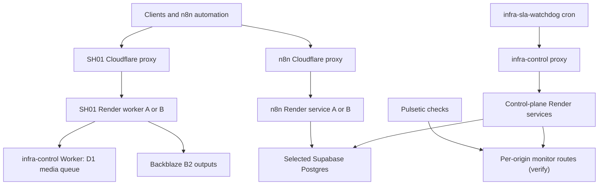

# SH01 project handbook

**Purpose:** This is the maintained starting point for a developer or AI with no prior conversation context. It maps the application to external infrastructure and records what is known, what was observed, and what still needs an export or dashboard check.

**Baseline checked:** GitHub `BarrieBretton/sh01-fastapi-server` `main` at `24f8924bd974418e309afdc48d83832f5e244c4e` on 20 October 2026. The operator also reported a successful Kaggle end-to-end branded video render on 20 October 2026. Configuration can change without a Git commit; check live dashboards before changing production.

## How to read and update this handbook

Evidence labels in the tables:

- **Code:** directly present in the named repository file at the baseline commit.
- **Observed:** operator supplied an HTTP response, working output, or direct result in this project. This is a point-in-time observation.
- **Reported:** described by the operator; the corresponding dashboard/export has not been inspected here.
- **Unknown:** a name, binding, URL, schedule, credential reference, or live state still needs recording.

When a deployment, n8n workflow, credential reference, cron, KV binding, or code path changes, update its section in this file in the **same change** that modifies the system. Record a non-secret proof: git commit, sanitized workflow export, Cloudflare Worker version/date, or a redacted health response. Never paste actual secrets, browser cookies, tokens, database URLs with passwords, signed media URLs, or live credential values into Git.

Read [README.md](../README.md) for local startup and sample calls; this document covers relationships and operational ownership. Source files and live settings take priority over either document if they differ.

## What lives in Git and what does not

| Surface | Where to find the authoritative definition | Recorded state |
| --- | --- | --- |
| FastAPI routes and data models | `app.py`, `auto_editor.py`, `caption_router.py`, `media_router.py`, `image_templating.py`, `infra/routes.py`; run `/openapi.json` for route schemas | Code |
| Shared media queue client and worker consumer | `media_job_store.py`, `media_dispatcher.py`, `media_capacity.py`, `media_admission.py` | Code |
| SH01 and n8n router implementations | `cloudflare/sh01-worker.js`, `cloudflare/n8n-prod-1-worker.js` | Code; confirm dashboard deployment version |
| Cloudflare infra-control router and D1 queue implementation, D1 schema and migrations | Dashboard-managed Worker/D1; **no source or migration history on GitHub `main` at this baseline** | Observed working queue health, source export missing |
| Current Worker variables, secrets, KV namespace IDs, D1 binding ID, schedules, per-origin pingers | Cloudflare dashboard; record **names, types and binding targets** here after inspection | Partial/unknown |
| Render service IDs, environment variable values, deploy revision, paired slot mapping | Render dashboards and live `INFRA_REGISTRY_JSON` | Partial/unknown |
| n8n workflow graphs, trigger cadences, node settings, pinned versions, HTTP Header Auth credential *names* | n8n UI; sanitized workflow exports **are not present in this repo** | Partial/unknown |
| Google Sheets schema, spreadsheet IDs, ownership, tabs | Google Sheets/Drive and n8n settings | Unknown |
| Media QA notebook | `notebooks/sh01_kaggle_branding_endpoint_test.ipynb` (include this file in the same handoff commit) | Operator observed successful video; sample repo artifact |
| Frontends/Cloudflare Pages | No Pages application source or deployment inventory found in this repo | Unknown, do not infer an app exists |

## System map



The control plane selects a **paired** n8n and SH01 Render slot; Postgres and B2 selections are independent. The current Render-to-letter mapping comes from the **live registry**, not from the A/B letter in a hostname or an older document. The media queue's D1 storage is distinct from router KV and from the active Supabase/Postgres slot.

### Public and internal entry points

| Name | URL / route | Responsibility | Evidence |
| --- | --- | --- | --- |
| SH01 public | `https://sh01.vivojaymail.workers.dev` | Stable media, Telegram, image, social, and other FastAPI routes | Code and observed |
| n8n public | `https://n8n-prod-1.vivojaymail.workers.dev` | Stable n8n proxy | Code and reported |
| Control public | `https://infra-control.vivojaymail.workers.dev` | Routes `/infra/*` to a control-plane instance; provides `/internal/media-jobs/queue/*` through its deployed Worker | Observed; Worker implementation not in Git |
| SH01 Render workers | `https://sh01-fastapi-server.onrender.com`, `https://sh01.onrender.com` | API origins behind SH01 router | Code router defaults; exact live mapping in dashboard |
| n8n Render services | `https://n8n-fbal.onrender.com`, `https://n8n-hbek.onrender.com` | n8n origins behind n8n router | Code router defaults; exact live mapping in dashboard |
| Master/control-plane Render | At least `https://sh01-fastapi-server-d0ya.onrender.com` previously observed; second origin is **not verified here** | Control API and infrastructure jobs | Observed one origin |
| Local or Kaggle server | `http://127.0.0.1:5000` in the tested notebook | High-resource test execution through the same FastAPI endpoints | Code and observed |

Router KV bindings are called `ROUTER_STATE` in the checked-in SH01/n8n Workers; give **each Worker its own KV namespace**. Exact namespace names/IDs and the control Worker's KV binding are not in Git. The D1 queue returned `{"ok":true,"queue":"cloudflare-d1"}` in an operator test on 18 October 2026, which does not verify its migration/version history.

## Credentials and boundaries

| Call | HTTP credential | Server-side setting / owner |
| --- | --- | --- |
| `/infra/*` through control proxy | `X-API-KEY` | Control-plane `CONTROL_PLANE_API_KEY` |
| `/internal/media-jobs/queue/*` | `X-MEDIA-JOB-KEY` | Media clients `MEDIA_JOB_STORE_API_KEY`; same key configured on deployed queue Worker |
| `/media/auto-edit*`, `/media/clip-caption*`, audio/image media job routes | `X-API-KEY` | SH01 media key `MEDIA_CLIP_API_KEY` (check fallback in `caption_router.py`) |
| SH01 and n8n `/__control/*` | `X-ROUTER-KEY` | Each Worker's `ROUTER_CONTROL_KEY`; control-plane matches via its role-specific router-key variables |
| `infra-sla-watchdog /tick` | `X-WATCHDOG-KEY` | Optional `WATCHDOG_MANUAL_KEY`; scheduled handler uses the control-plane API key instead |
| Threads, Tumblr, X posting | `X-API-Key` | Platform-specific internal key resolution; see `docs/SOCIAL_DISTRIBUTION.md` |

An n8n HTTP Header Auth credential for SH01 media must set **header name `X-API-KEY` and value the media key**. The control-plane key and queue key are not substitutes. Keep a credential register consisting of **name, use, rotation date, owner, and target environment** without the secret itself.

### Runtime settings worth documenting per deployment

| Group | Names to inspect | Reason |
| --- | --- | --- |
| SH01 queue | `MEDIA_JOB_STORE_MODE=remote`, `CONTROL_PLANE_BASE_URL`, `MEDIA_JOB_STORE_API_KEY`, `MEDIA_QUEUE_CONSUMER_ENABLED`, `MEDIA_QUEUE_POLL_SECONDS`, `MEDIA_QUEUE_HEARTBEAT_SECONDS` | Enqueue/claim and heartbeat |
| SH01 media | `MEDIA_CLIP_API_KEY`, `PUBLIC_API_BASE`, `MEDIA_CLIP_RENDER_WIDTH`, `MEDIA_CLIP_RENDER_HEIGHT`, `MEDIA_CLIP_WHISPER_MODEL`, `MEDIA_CLIP_WHISPER_VAD` | Authentication, render dimensions, transcription |
| Low-resource guard | `MEDIA_ALLOW_UNLIMITED_RESOURCES`, `MEDIA_REQUIRE_CGROUP`, `MEDIA_CGROUP_RESERVE_MB`, `MEDIA_FFMPEG_MAX_RSS_MB`, `MEDIA_WHISPER_MAX_RSS_MB`, `MEDIA_MAX_INPUT_PIXELS` | Render memory admission, not an OOM guarantee |
| B2 | `BACKBLAZE_KEY_ID`, `BACKBLAZE_APPLICATION_KEY`, `BACKBLAZE_BUCKET_NAME` | Durable rendered video and Telegram media |
| Control plane | `CONTROL_PLANE_API_KEY`, `INFRA_REGISTRY_JSON`, `ACTIVE_RENDER_SLOT`, `ACTIVE_POSTGRES_SLOT`, `ACTIVE_B2_SLOT`, `RENDER_API_KEY`, router URLs and keys, `SUPABASE_{A,B}_*` | Provider configuration and bootstrap state |
| n8n/Redis | n8n `DB_POSTGRESDB_*`, shared `N8N_ENCRYPTION_KEY`; app `REDIS_URL`, `N8N_BASE_URL`, `N8N_API_KEY` | n8n persistence/decryption and app daily activation |

The `REDIS_URL` path in `app.py` attempts a Redis `cron_master_lock` and schedules n8n activation at **09:50 Asia/Kolkata**. A live Redis instance, active lock owner, and successful execution of that scheduler have **not been verified**. Do not classify a source-code CronTrigger as an enabled production schedule without dashboard/runtime evidence. Similarly, note the control plane's in-process SLA lock in `infra/sla.py`: multiple independent master processes do not automatically coordinate a global leader.

## Media production contract and the tested notebook

`POST /media/auto-edit` accepts **exactly one** `source_url`, `telegram_file_id`, or `source_path`. Its durable job is enqueued through the infra-control D1 queue and picked up by an opted-in SH01 consumer. Poll `GET /media/auto-edit-jobs/{job_id}`; finished results include video URLs, source/output edit intervals, and per-shot zoom metadata. `GET /media/auto-edit-presets` returns preset starting values and `GET /media/auto-edit-capabilities` reports instance settings. See `auto_editor.py`, `media_branding.py`, and `caption_router.py` for exact validation.

The sample notebook in this documentation package exercises a synced video, user-selected source window, Whisper transcription and VAD, silence cuts, phrase-bounce captions with word highlighting, portrait crop, selected-shot zoom, gradients, four corner logos, moving edge text, an image template, and B2 output. The operator confirmed a successful result on Kaggle on 20 October 2026. This verifies **that run**, not all inputs, Render's 512 MiB performance, every UI workflow, or all preset combinations.

The notebook starts one local SH01 process and uses HTTP endpoints for editing and image generation. Its optional `ffmpeg` call to sync an attached MKV is input preparation; its `ffprobe` checks are verification. If pip upgrades Pillow while the notebook kernel holds old Pillow modules, restart the **kernel** before importing `auto_editor` and rerun setup. Do not include Kaggle-specific cookies, private videos, output files, or rendered B2 URLs in Git.

`unlimited_resources=true` works only on a host with `MEDIA_ALLOW_UNLIMITED_RESOURCES=true`. Keep it **false** for the small Render workers. `source_path` resolves on the **claiming worker**, so a Kaggle path cannot be used through the public Render proxy. A queued job can run on a different SH01 instance; prefer a reachable source URL or Telegram file ID for production.

### Converting the Kaggle run to n8n

The core SH01 render can be orchestrated with standard n8n nodes:

1. **Trigger / input:** receive an already accessible MP4 `source_url` (or a Telegram file ID), time window, preset/overrides, and a stable request ID. Validate that the URL is accessible to the worker.
2. **Set/Edit Fields:** build an auto-edit JSON body. Reuse the notebook's `VIDEO_REQUEST` values for captions, zoom shots, crop and branding; change `source_path` to `source_url` or `telegram_file_id` and `unlimited_resources` to `false` for Render.
3. **HTTP Request:** POST `https://sh01.vivojaymail.workers.dev/media/auto-edit` with an n8n Header Auth credential whose **name is `X-API-KEY`** and value is `MEDIA_CLIP_API_KEY`; save `job_id` and `request_id`.
4. **Wait + HTTP Request + IF:** poll `/media/auto-edit-jobs/{job_id}` with the same header; loop while `queued` or `running`, branch on `complete` and `failed`/`interrupted`. Bound attempts and time; preserve the returned error for investigation.
5. **Output:** read `outputs[0].video_url`; distribute, notify, or append a job result to a **dedicated** sheet. Keep the edit decision list to verify silence cuts and zoomed shots.

The HTTP API does **not** currently provide the Kaggle notebook's YouTube extraction or its FFmpeg source-sync step. A YouTube URL with a desired 01:09:30–01:12:30 region is not equivalent to an MP4 `source_url`. To automate that exact acquisition step, build and verify an accessible preprocessing service or supply a prepared publicly reachable MP4 first. Running the 180-second, fully branded workload on a 512 MiB Render worker may be refused or fail resource admission; the successful Kaggle run does not establish Render capacity. A production-equivalent n8n workflow should be tested against its actual worker and a representative input before activation.

Export any finished n8n workflow as a sanitized JSON file under `workflows/` and document its name, owner, trigger, cadence, dependent child workflows, credentials **by name only**, stable endpoint URLs, failure path, and last successful execution below. No export is present in the repository at this baseline.

## External systems and workflows register

The following list is intentionally incomplete until the owner inspects the named UIs. Replace `unknown` with actual IDs, **not** secret values. One row per real service/namespace/workflow/monitor is needed.

| System / item | Source of truth | Known information | Missing verification |
| --- | --- | --- | --- |
| Cloudflare SH01 proxy | Workers dashboard and `cloudflare/sh01-worker.js` | `BACKENDS`, `ALLOW_FALLBACK`, `ROUTER_CONTROL_KEY`, `ROUTER_STATE`, `/__control/*`; `x-backend-used` on proxied calls | Current deployment version, preferred origin, KV namespace ID |
| Cloudflare n8n proxy | Workers dashboard and `cloudflare/n8n-prod-1-worker.js` | Same router contract; separate KV binding | Current deployment version, preferred origin, KV namespace ID |
| Cloudflare infra-control proxy/queue | Workers + D1 dashboard | Public URL above; D1 queue health previously returned `cloudflare-d1` | Exported Worker source, D1 database/binding ID, schema/migrations, router KV ID, installed secrets' **names** |
| Cloudflare infra-sla-watchdog | Workers dashboard and checked-in JS | Scheduled handler calls `/infra/sla/tick`; manual `/tick` protected; proposed source treats unsuccessful JSON ticks as failures | Actual cron trigger expression, last run, deployed version |
| Other Workers, Pages, KV namespaces and caches | Cloudflare dashboard | Operator reports more components | Names, routes, owners, bindings, contents policy |
| Render SH01 A/B, n8n A/B, control A/B | Render dashboard | SH01/n8n URLs above; one master origin previously observed | Every service ID, live commit, environment scope, live registry pairing |
| Supabase/Postgres A/B | Render env, active registry, Supabase UI | Separate logical slots; n8n pooler may use 6543; migration uses 5432 | Actual project IDs, slot mapping, restore test, current replication/freshness |
| Backblaze B2 | B2 UI and active registry | `b2-a` reported active; job outputs stored on B2 | Bucket names, B2-b provisioning, lifecycle and access policies |
| n8n production workflows | n8n UI and future `workflows/` exports | Existing social distribution, Telegram audio and image automation discussed | **All** active/published workflows, triggers, node graphs, child dependencies, schedule/time zone, last run |
| n8n credentials | n8n UI | Header Auth for media must set `X-API-KEY`; social auth may use distinct key | Credential display names, intended header names, owner, scopes/rotation date (no values) |
| Google Sheets | Google UI and n8n exports | Telegram storage and existing logging tabs; proposed dedicated video job sheet | Spreadsheet/tab IDs, schemas, access owner, workflow mapping |
| Telegram | SH01 app and Telegram/n8n UI | `/telegram/*`; bot and storage keys | Bot identity, chat IDs, storage sheet binding, workflow webhook mapping |
| Meta/Facebook/Instagram/Threads | App and Meta UI; `docs/SOCIAL_DISTRIBUTION.md` | Legacy FB posting, Threads backend, n8n publishing | App IDs, page/account mapping, credential metadata, live platform permissions |
| Tumblr / X / TikTok | Social modules and provider UIs | Tumblr backend; X backend parked in checked docs; TikTok workflow scaffold only | Live account mapping, activated workflows, future API authorization |
| ImageKit, Kite, Cloudinary | SH01 code and service UIs | ImageKit upload path, Kite integration; Cloudinary references in historical config | Actual use, keys' locations, deployed image workflow |
| Pulsetic | Pulsetic UI | Operator reports roughly five-minute per-origin pings | Each monitor URL, frequency, expected upstream, last success; prove pinned routing via `x-backend-used` |
| Redis | Render/Redis UI and SH01 startup logs | `app.py` references `REDIS_URL` and a cron lock | Actual server, reachability, lock renewal and current cron execution |

### October 17 SLA maintenance incident and recovery changes

**Operator-observed:** On 2026-10-17 around 17:05 UTC, the controller attempted a `render-b` to `render-a` failover. Render rejected `POST /resume` for `render-a/n8n` with HTTP 400, `only services suspended by a user can be resumed`. Controller logs then show maintenance enabled on both routers and suspend requests sent to the serving `render-b` services. The monitor reported `hard_stop=true`, `last_reason=render_ring_failed_completely`. The n8n router remained in maintenance until the operator cleared it manually on October 19; subsequent checks showed readiness 200 through the proxy and the monitor no longer in hard stop. Intermittent n8n/Postgres timeouts appear in the logs, but the excerpt does not prove the precise trigger of the October 17 health checks or every service's actual uptime.

**Proposed code behavior (verify deployment before relying on it):** Failover rejects a nonresumable Render target before modifying the serving pair. A hard stop freezes the routers but does not suspend Render services; each subsequent SLA tick checks for a healthy active pair or a healthy, runtime-matched standby and reopens ingress if recovery succeeds. Watchdog `POST /tick` reports unsuccessful controller JSON results as failures even when the controller returns HTTP 200. The Worker source is copied into Cloudflare's dashboard separately; committing this repository alone does not deploy it. `/health` checks only the watchdog Worker, and logs are not a substitute for an alerting destination. During a hard stop, inspect `/infra/sla/status`, both router statuses, both origins' readiness, and the watchdog tick result; do not clear maintenance until the selected pair is healthy and routing matches.

### n8n workflow register template

For **every** published workflow and every child dependency, add one block (or a table row plus linked details):

```text
Workflow name / ID:
Export path in workflows/:
Environment and public trigger URL (redacted if private):
Owner; published/active status; last verified UTC:
Trigger: webhook / parent workflow / cron; schedule + timezone:
Upstream workflow IDs:
Downstream Execute Workflow calls:
External HTTP node names -> URL + method + authentication CREDENTIAL NAME:
Input/output JSON contract and idempotency key:
Sheet/database writes:
Retry, rate-limit, failure-alert and manual replay paths:
Last successful execution ID; known limitations:
```

Do not assume that source code's `DEFAULT_WORKFLOWS` list in `app.py` is the current list of active n8n workflows. Exports plus the n8n published/active UI state are required to answer that.

## Operations and change workflow

1. Confirm `git rev-parse HEAD` matches the deployment you are documenting. Capture current `/infra/health`, `/infra/status`, and each router's `/__control/status` with the correct header, then redact credentials. Record the returned active slot and `x-backend-used` as time-stamped observations.
2. Export the dashboard-managed infra-control Worker code and D1 schema/migrations, without secrets. Add reviewed source under `cloudflare/` and schema under `cloudflare/migrations/` before claiming the queue can be reconstructed from Git.
3. Inventory **every** Cloudflare Worker, route, KV namespace, D1 database/binding, Cron trigger, and Pages site in the UI. Fill the unknown cells and preserve binding names, IDs, and owners.
4. Export every published n8n workflow (including child workflows), record credential *names* and redacted node contracts, and add a dependency graph. Record execution schedules in their configured time zones; do not assume a code-side scheduler owns n8n's schedules.
5. Capture Render service IDs, live repo revisions, paired registry mapping, Supabase slots, B2 buckets, and Pulsetic monitor-to-origin mappings from the UIs. Keep secrets in secret managers.
6. Commit this handbook, sanitized workflow exports, and the working Kaggle notebook with any implementation change. Re-run a small low-resource job on Render and a representative high-resource job on Kaggle before declaring a new media feature production ready.

**Release/readiness test:** A new engineer or AI should be able to use only this repository and its documented read-only dashboard access to enumerate every service, reproduce a non-secret environment, trace a triggered n8n item through HTTP, D1, SH01 and B2, locate every credential **by name**, diagnose a failed job, and reconstruct Cloudflare Worker source and D1 migrations. Until the unknowns in this file are resolved, that test does not pass.

## References

- [Root overview, configuration and API samples](../README.md)
- [Control-plane setup](../CONTROL_PLANE_SETUP.md) and [paired Render migration](../PAIRED_RENDER_MIGRATION.md)
- [Infrastructure smoke checklist](../TEST_CHECKLIST.md)
- [Social distribution implementation and current status](SOCIAL_DISTRIBUTION.md)
- [Kaggle media regression notebook](../notebooks/sh01_kaggle_branding_endpoint_test.ipynb)

`MEDIA_JOB_STORE_SETUP.md` in this documentation package describes the current D1 queue arrangement. If you encounter a copy that points to a direct Render master URL, replace that older copy before following its installation steps.
